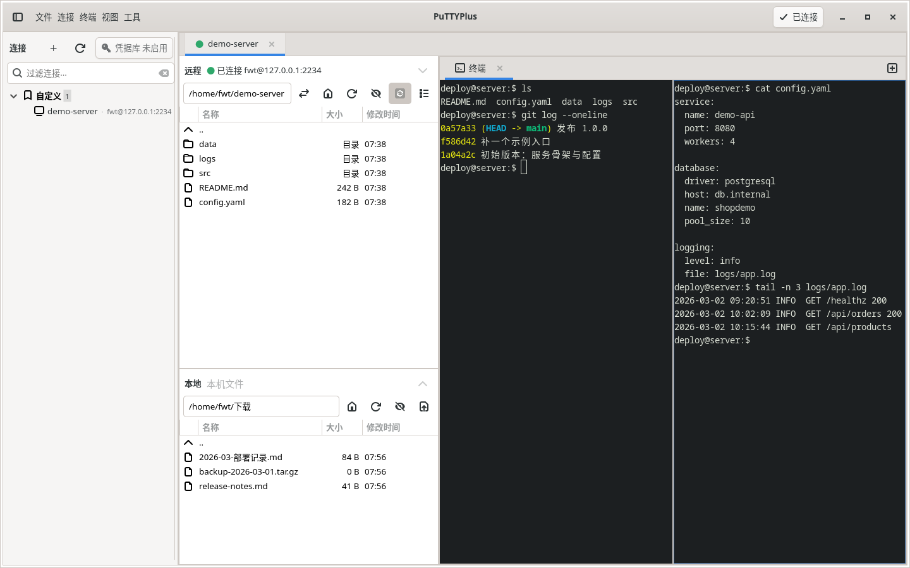
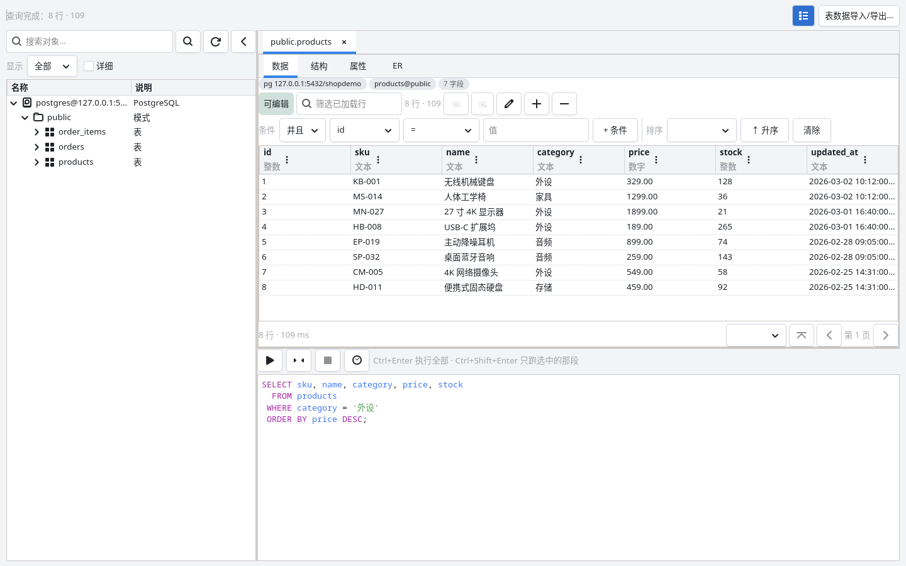

# PuTTYPlus

[](https://github.com/fwt11/puttyplus/actions/workflows/ci.yml)

**PuTTY 兼容的 SSH 终端 + 图形化 SFTP + 数据库工作台** —— Linux 桌面上的单文件程序，界面全中文。

技术栈：GTK4 + VTE4 + russh + russh-sftp。SSH/SFTP 协议栈与加密库全部静态打进一个
可执行文件，运行时只需要 GTK4 / VTE4 两个运行库。



## 项目缘起

这个项目最早解决的是一个很具体的问题：**Linux 上没有「带图形化 SFTP 的 PuTTY」**。

PuTTY 本身只有终端，传文件得另开一个客户端；Linux 上的图形化 SSH 客户端大多把终端
和文件面板拆成两个程序，切换一次就要重新登录一遍。而日常在服务器上敲命令、传文件、
改配置的人，其实只想要一个窗口：右边是终端，左边是文件面板，两边用**同一条连接、
同一套账号密码**。

于是 PuTTYPlus 最初只是一个小工具：命令行完全照着 PuTTY 来，起来之后左边自动开一个
SFTP 双栏面板。用着写着，需求变了两次。

**第一次变化：它得能被「顶替 PuTTY」用在堡垒机上。**
不少堡垒机的「本地 SSH 客户端」这一格填的是一个可执行文件路径，填谁就拉起谁。调用方
只会按 PuTTY 的方式传参：`-ssh user@host -P 2222 -pw xxx`，可能还带 `-load 预置会话`、
`-title 账号@设备IP`。这意味着**命令行不再是"差不多就行"，而是一份逐字节的契约**：
参数怎么解析、`--print-config` 打出什么、退出码是多少、askpass 怎么应答、spawn 出去的
ssh 子进程长什么样 —— 每一处都要和 PuTTY 对得上。

于是这份契约被写成了文档（[`docs/命令行契约.md`](docs/命令行契约.md)），并用 **73 条
黄金基准**做回归：改参数之前先跑一遍，改完再跑一遍，必须还是 `PASS=73 FAIL=0`。

**第二次变化：服务器上的数据库，也该在同一个窗口里看。**
连上堡垒机之后，真正让人抓狂的是「数据库还得开另一个工具」。于是有了**数据库工作台**：
对象树、表结构、可编辑的数据网格、SQL 编辑器、导入导出、ER 图 —— 而且**数据库通道直接
复用当前这条 SSH 连接**（走 direct-tcpip 转发），不另开端口、不另建连接、不在机器上
留监听。

到今天，它是一个能顶替 PuTTY 的终端客户端，也是一个能改数据的数据库客户端，而这两件事
在同一个窗口里。

## 项目特色

### 一、命令行与 PuTTY 兼容

| 参数 | 说明 |
|---|---|
| `-ssh` `-telnet` `-rlogin` `-raw` `-serial` | 协议开关 |
| `[user@]host` | 位置参数；恰好匹配已保存会话名时自动加载该会话 |
| `-P <port>` `-l <user>` | 端口 / 用户名 |
| `-pw <pw>` `-pwfile <f>` | 密码；`-pwfile` 只取第一行，读完即弃 |
| `-i <key>` | OpenSSH 格式私钥（`.ppk` 需先用 `puttygen` 转换） |
| `-load <session>` | 加载 `~/.putty/sessions/` 下的会话 |
| `-m <file>` | 远程命令 |
| `-L` `-R` `-D` | 本地 / 远程转发与 SOCKS 代理 |
| `-N` `-t` `-T` `-4` `-6` `-C` `-v` `-batch` | 透传 |
| `-proxycmd <cmd>` | 透传给 ssh（`ProxyCommand=`） |
| `-title <t>` / `-title=<t>` | 窗口标题 |
| 未知参数 | 记录警告后忽略，**不会吞掉后面的值** |

- `--print-config` 打印解析结果并退出，**不启动 GUI**（密码只打 `<set>`，绝不打明文）。
- 实现了 ssh 的 **askpass 协议**：程序发现 `SSH_ASKPASS` 指向自己时自动进入应答模式，
  所以堡垒机那条链路上不需要额外包装脚本。
- 完整契约（含 `--print-config` 的逐字节格式、spawn 出去的 ssh/plink 参数形状）
  见 [`docs/命令行契约.md`](docs/命令行契约.md)。

### 二、一个窗口：终端 + 双栏文件

- **远程 / 本地双栏**，两边共用同一条 SSH 连接；上传下载支持**拖拽**（从文件管理器拖进
  远程面板、或直接拖到终端里）。文件管理器**不肯给拖拽数据**时（Deepin 文件管理器就是
  這樣），远程列表右键「**粘贴上传**」也能传：在文件管理器里 `Ctrl+C` 复制，再点它。
- **传输队列**：整批一个队列，进度显示在文件名后面，支持取消、可调并发（复用同一条
  连接，不额外新建 SSH/TCP 连接）。
- **终端跟随目录**：远程 shell 上报目录时（OSC 7）即时跟随；没有 OSC 7 的环境则通过
  exec 通道轮询 `/proc` 找登录 shell 的工作目录，对常见的 bash / zsh 通用。
- **内置文本编辑器**：行号 + 语法高亮（20 多种语言），可以直接编辑**远程**文件（走
  当前 SFTP 连接，不用先下载）。打开**非文本文件**时会先问一句要不要**以 hex 模式
  打开**（同意才开，按 `hexdump -C` 的布局摊开原始字节；hex 模式只读，存不回去）。
- **会话结束后能救回来**：终端区会摆出「会话已结束 · 点此重新连接」，右键菜单里也有
  「重新连接终端」；关掉的终端页签点重连会重建出来。
- **分屏**：一个终端页签里可以左右 / 上下切分，同时盯住几路输出（顶部「终端」菜单 →
  「左右分屏」/「上下分屏」；右键菜单里也能从当前那块分）；每个终端页签各有一组
  自己的分屏布局，互不干扰。
- **终端引擎可以自己选**：**libvte**（Linux 的 GTK 终端控件）与 **ghostty**
  （Ghostty 的终端内核，Windows 版用的就是它）**编进同一个二进制** ⇒ 首选项
  「终端」页有个「终端引擎」下拉框随时切（只对新开的终端生效；Windows 上没有
  这一项 —— 那边只有 ghostty）。⚠️ ghostty 引擎还在完善中：自定义配色、鼠标
  拖选复制、录制回放暂不可用。
- 终端查找、复制粘贴、按键广播、终端日志、会话录制与回放。

### 三、数据库工作台



- **对象树**：模式 → 表 / 视图 → 列 / 索引，**展开才查**（不一次性拉全库元数据）；
  顶部搜索框可以在**整个库里搜对象**（表、视图、字段、函数、存储过程、触发器、事件）。
- **一张表 = 一个文档页**，页内四个视图：**数据 / 结构 / 属性 / ER**；后两个懒建，
  不会为了看一眼数据就把整个模式的元数据拉一遍。
- **可编辑的数据网格**：点「编辑」才开事务、才允许改单元格；「保存修改」把每行拼成
  UPDATE 执行（WHERE 用主键，没有主键就用整行原值定位），**全部成功才 COMMIT，任何
  一条失败就整体 ROLLBACK** —— 绝不自动提交。视图只读。
- **结构也能改**：字段、索引、外键三张表都能双击编辑，改动会打包成**一条** DDL 执行，
  要么全成功、要么全不动；可能丢数据的操作会先弹确认框并把语句摆出来。
- **SQL 编辑器**：语法高亮、执行全部 / 只跑选中的那段、**执行历史**（双击填回编辑器，
  不自动执行）。
- **筛选＝一个宽 WHERE 框**：写完**回车就重新查库**；旁边的 ▾ 条件助手按列类型
  转义生成一段条件（填进去还能接着改，按回车才生效）。底栏**常驻显示当前正在
  执行的 SQL**，还有一颗「统计总行数」（当场数一遍 `count(*)`，跟对象树里那个
  带 ≈ 的估算值不是一回事）。
- **表属性页带「建表语句」**：`CREATE TABLE` 原文，带语法高亮、只读、可复制
  （视图没有——视图的定义得问数据库自己）。
- **导入导出**：CSV 导入有字段映射向导（默认按列名自动配对，整批一个事务，失败全部
  回滚）；导出支持 CSV（带 BOM）、INSERT SQL、JSON、XML、HTML 表格。
- **ER 图**：把这张表跟外键相关的表画成关系图，箭头落在具体列上，表框可以拖动。
- **连接挂在 SSH 会话下面**：数据库通道是当前那条 SSH 连接的 direct-tcpip 转发，
  天然属于它 —— 不占固定端口，SSH 一断数据库通道也就没了。

### 四、凭据库

- 主密码 + argon2 派生密钥 + AES-GCM 加密；文件头明写 `protected=false/true`，
  一眼能看出这份库到底加没加密。
- **状态常驻可见**：顶栏和连接管理器各有一颗标志，四种状态（未启用 / 已解锁 /
  已锁定 / 未加密）各有配色，不会出现「以为存加密了其实是明文」。
- **忘了主密码有出路**：解锁框里有一颗「忘记主密码？重置凭据库」，密码输错时对话框
  不关，就地提示并指路。重置 = 丢掉旧密码、换一个空库，**连接列表、数据库连接定义、
  「记住密码」的勾选都不受影响**。

### 五、录制与回放

- 终端会话可录成 **asciicast v3**（也能读 v2），回放时能看能跳。
- 录制的是**屏幕内容**，不含输入事件 —— 也就是说**不会把密码录进去**。
- 回放说明里写清楚了录制到底记了什么，别让人误以为能逐键复现。

### 六、其它

- **连接管理器**：左边是会话树（最近 / 自建 / `~/.ssh/config` 别名），双击即连；支持
  在新窗口打开（密码走环境变量，不进 `argv`）。
- **端口转发**：结构化表格（类型 / 监听 / 目标 / 机制 / 启用），双击即改。
- **快速命令面板**：把预设命令敲进当前终端。
- **私钥管理器**：列出本机私钥、生成新密钥、导入导出。
- **串口会话**：`-serial` + 设备路径当位置参数，支持 `-sercfg` 设串口参数。
- **设置集中在一个窗口**：外观 / 终端 / 传输 / 安全 / 快捷键 / 高级，每项设置只有
  一个归属页。
- **主题**：浅色 / 深色 / 跟随系统，次要文字按 WCAG AA 计算对比度，不是随手取的灰。

## 下载

到 [Releases 页](https://github.com/fwt11/puttyplus/releases) 取最新版本：

| 资产 | 用途 |
|---|---|
| `puttyplus_<版本>-1_amd64.deb` | x86-64 的 Debian / Ubuntu 等发行版安装包（依赖 GTK ≥ 4.18、VTE ≥ 0.80） |
| `puttyplus_<版本>-1_arm64.deb` | arm64（aarch64）同上，树莓派 / ARM 服务器 / ARM 笔记本用这个 |
| `puttyplus-linux-x86_64.tar.gz` | 免安装的单文件版（x86-64）：解开直接跑 `puttyplus` |
| `puttyplus-linux-aarch64.tar.gz` | 免安装的单文件版（arm64） |
| `puttyplus-windows-x86_64.zip` | **Windows 版**（实验）：解压后双击 `puttyplus.exe` 即可（GTK 的 DLL 都在包里；图标主题没带，可能显示不出图标，不影响功能） |
| `SHA256SUMS` | 校验和（`sha256sum -c SHA256SUMS`） |

```bash
# 装 deb（<版本> 换成 Releases 页上的那个，例如 0.3.0）
sudo dpkg -i puttyplus_<版本>-1_amd64.deb      # x86-64
sudo dpkg -i puttyplus_<版本>-1_arm64.deb      # arm64

# 免安装版
tar xf puttyplus-linux-x86_64.tar.gz         # 或 ...-aarch64.tar.gz
./puttyplus
```

## Windows 版（实验）

跨平台改造已经合进 `main`（开发过程在 `feature/cross-platform` 分支）：
**Windows 优先**，首版只承诺三件事与 Linux 版一致——

| 能力 | Windows 状态 |
|---|---|
| **终端会话** | ✅ 可用。终端内核换成 **libghostty-vt**（Ghostty 的终端内核）+ 自绘渲染（cairo + pangocairo），中文输入法自己挂。**SSH 优先用系统里的客户端**（有 `ssh.exe` / `plink.exe` 就 spawn 它 ⇒ 语义跟 Linux 版一样）；**一个都没有才走进程内**（russh 直接驱动终端内核）⇒ **不装任何外部程序也能跑** |
| **SFTP 文件面板** | ✅ 可用。列表、上下级、新建、重命名、删除、传输队列、拖拽上传、剪贴板粘贴上传 |
| **命令行参数契约** | ✅ 与 Linux 版**逐条一致**：同样那 73 条黄金基准，PASS=73 FAIL=0 |

另外两块**特色功能在 Windows 上也开放了**（2026-11-10）：

| 能力 | Windows 状态 |
|---|---|
| **端口映射**（`-L`/`-R`/`-D`） | ✅ 可用。由本程序自己的**进程内转发**承接（走 SSH 的 `direct-tcpip` 通道）——⚠️ 承接方看的是「终端用哪条路连」，不是「系统里有没有 ssh」 |
| **数据库工作台**（PostgreSQL / MySQL） | ✅ 可用。⚠️ **一处部署侧差别**：Unix 上 PostgreSQL 走本地套接字（远端多半不校验密码），Windows 走 `127.0.0.1` 回环 TCP ⇒ 远端 `pg_hba.conf` 必须放行 TCP + 密码认证 |

⚠️ **Windows 上的 SSH 走哪条路**（阶段 3，2026-11-10 用户拍板）：

- **系统里有 `ssh.exe`（或 `plink.exe`）⇒ 就 spawn 它** ⇒ 终端里跑的
  是**用户自己的客户端** ⇒ `~/.ssh/config`、agent、ProxyJump、known_hosts
  的语义**跟 Linux 版一样**；
- **一个都没有**（Windows 默认没装 OpenSSH，它是「可选功能」）⇒ 兜底走
  **进程内**的 SSH（russh 直接驱动终端内核）：申请远程 pty、开 shell、
  键盘字节直接写进去、窗口尺寸用 SSH 的 window-change 告诉远程端。
  ⇒ **跑起来不需要任何外部程序**（连 Git Bash 都不用，只有「跑 73 条契约」
  才需要）。

⚠️ **与 Linux 版的已知差异**（Linux 主线**不变**，仍然是 spawn 用户自己的
`ssh` ⇒ `~/.ssh/config`、agent、ProxyJump 的语义全都在）：

- ⚠️ **只有走进程内那条路时**（系统里没有 `ssh.exe` / `plink.exe`），
  Windows 版终端才**不读 `~/.ssh/config`**（别名展开由本程序自己做，
  `HostName`/`Port`/`User`/`IdentityFile` 生效，但 **ProxyJump 等不支持**）
  ⇒ **装了 OpenSSH 就没这个差异**；
- 走进程内那条路时，端口转发走本程序自己的进程内转发，不经 `ssh -L/-R/-D`
  （走 spawn 那条路时转发进 ssh 的 argv，与 Linux 版一致）。

**首版不做 / 未验证的**：

- **桌面通知**：Windows 首版不做（状态栏有一句兜底）。
- **录制/回放**：ghostty 内核的 `cursor_row()` 是视口内行号、与 VTE 的绝对行号
  语义不同 ⇒ 录制在 ghostty 后端暂不准（Linux 的 VTE 后端不受影响）。
- **终端引擎切换**：Windows 上没有这一项（那边没有 VTE，只有一个可选）。

构建（**只能在 Windows 上编**，Linux 交叉编译会卡在 `glib-sys` 需要的 Windows
sysroot 上）：

```powershell
# 一条命令搞定：检查 Rust(MSVC) → 备好 GTK4 与 Zig → 编译 → 跑 73 条契约
powershell -ExecutionPolicy Bypass -File tools\win_build.ps1
```

脚本干的事（跟 CI 里那套一样，细节见 `tools/win_build.ps1` 的注释）：

```powershell
# 1) Rust（msvc 目标，windows-latest runner 自带 MSVC）
rustup toolchain install stable-x86_64-pc-windows-msvc

# 2) GTK 4 开发库（Windows 上没有系统包，用 gvsbuild 的预编译版）
#    解压到 C:\gtk 后，它自己的 bin/ 要进 PATH，并设置：
$env:PKG_CONFIG_PATH = "C:\gtk\lib\pkgconfig"

# 3) Zig 0.17.x（编译 libghostty-vt 要用）
pip install ziglang==0.17.1
$env:PATH = "<python -c "import ziglang,os;print(os.path.dirname(ziglang.__file__))">;$env:PATH"

cargo build --release
.\target\release\puttyplus.exe
```

⚠️ **exe 单独拿走跑不起来**：GTK / glib / pango 的 DLL 都在 `C:\gtk\bin` 里
⇒ 要拷走就把那些 DLL 一起放在 exe 旁边。

跑命令行契约检查（Windows 上用 Git Bash）：

```bash
bash tools/cli_contract_check.sh --selftest   # 先验归一化逻辑本身
bash tools/cli_contract_check.sh              # 73 条黄金基准
```

⚠️ **GUI 那一半只能真机验**（CI 的 Windows runner 没有桌面会话，GTK 起不来）：
清单见 [docs/跨平台-构建说明.md](docs/跨平台-构建说明.md) 的「Windows 真机验证清单」。

细节（两个终端引擎、Zig 怎么装、pangocairo 的坑、ConPTY 的坑、路径语义）
见 [docs/跨平台-构建说明.md](docs/跨平台-构建说明.md)。

## 快速开始

### 依赖

- Rust（edition 2024 ⇒ 需要 rustc 1.85 以上；用 rustup 装 cargo 即可）
- GTK ≥ 4.18、VTE ≥ 0.80（发行版里的包名一般是 `libvte-2.91-gtk4-dev`）

```bash
sudo apt install build-essential pkg-config libgtk-4-dev libvte-2.91-gtk4-dev
```

### 编译

```bash
cargo build --release
./target/release/puttyplus
```

产物是单个可执行文件（`target/release/puttyplus`），SSH 与加密全静态，拷到别的机器上
就能跑，只要那台机器有 GTK4 / VTE4。

> **glibc 兼容性**：打包时会摘掉弱符号（`pidfd_*`）的 glibc 版本标签，deb 的依赖
> 因此停在 `libc6 (>= 2.34)` —— 即便是在 Debian 13 / Ubuntu 25.04（glibc 2.41）上
> 编出来的包，也能装到 glibc 2.34 及以上的系统上（Deepin 25 是 2.38）。

### 打包成 deb

```bash
bash tools/build_deb.sh            # 只打包（架构跟本机走）
bash tools/build_deb.sh --test     # 先跑单元测试再打包
sudo dpkg -i puttyplus_<版本>-1_amd64.deb
```

⚠️ **包名里的架构是打包机器的架构**（amd64 / arm64）——在 arm64 机器上跑
上面的脚本，出来的就是 `_arm64.deb`。发布用的两个架构由 GitHub Actions
分别构建（见下）。

包里带桌面菜单项、图标和中文手册页。

## 使用

### 顶替 PuTTY（堡垒机场景）

1. 在客户端的「本地 SSH 客户端」里，把路径指到 `puttyplus`；
2. 若对方按文件名固定找 `putty`，做个软链：
   `sudo ln -s /usr/local/bin/puttyplus /usr/local/bin/putty`；
3. 正常发起连接即可 —— 调用方传的参数不用改。

⚠️ **连「本地隧道」出来的回环地址（`127.0.0.1:<端口>`）时不做主机密钥校验**：
堡垒机常在本地开一个**随机端口**、并且隧道**按访问轮换密钥** ⇒ 按
`[地址]:[端口]` 记的 `~/.ssh/known_hosts` 必然对不上 ⇒ 会被
「REMOTE HOST IDENTIFICATION HAS CHANGED」**直接挡住**（分屏开不出来）。
⇒ 这种目标**不查也不写** `known_hosts`（普通地址照旧校验）。

### 连接管理器

无参数启动会打开连接管理器：左边是会话树（最近 / 自建 / `~/.ssh/config` 别名），
双击即连；自建的连接存在 `~/.config/puttyplus/connections.ini`（权限 0600），
**不会去改 `~/.ssh/config`**。

### 配置文件

| 路径 | 内容 |
|---|---|
| `~/.config/puttyplus/settings.ini` | 首选项（外观、终端、传输、安全、快捷键…） |
| `~/.config/puttyplus/connections.ini` | 自建连接（含密码，0600） |
| `~/.config/puttyplus/databases.ini` | 数据库连接定义 |
| `~/.config/puttyplus/history.ini` | SQL 执行历史 |
| `~/.config/puttyplus/columns.ini` | 列显示设置（按连接 + 表分开存） |
| `~/.config/puttyplus/recent.ini` | 最近连接 |
| `~/.config/puttyplus/credentials.vault` | 凭据库（加密） |

### 常用环境变量

| 变量 | 作用 |
|---|---|
| `SSHPASS` | 命令行没给密码时的兜底来源（sshpass 约定） |
| `PUTTYPLUS_FONT` | 终端字体，如 `"Monospace 12"` |
| `PUTTYPLUS_LOCALDIR` | 本地面板起始目录（默认 `~/Downloads`） |
| `PUTTYPLUS_FOLLOW_MS` | 终端跟随目录的轮询间隔（毫秒，0 关闭） |
| `PUTTYPLUS_WATCH_MS` | 文件列表的自动刷新间隔（毫秒，0 关闭） |
| `PUTTYPLUS_CAPTURE_DIR` / `PUTTYPLUS_LOG_DIR` | 录制 / 日志的落盘目录 |
| `PP_TERM_BACKEND` | 强制终端引擎（`ghostty` / `vte`），盖过首选项里的设置；自测用 |

## 目录结构

```
src/          应用代码（lib + bin）
  panel/      文件面板、数据库工作台、转发规则、任务队列
  backend/    SSH / SFTP / 数据库后端
examples/     GUI 冒烟与截图脚本（每个都是一条可跑的自检）
tools/        打包脚本 + 命令行契约回归
debian/       Debian 打包目录
docs/         [功能说明](docs/功能说明.md)、[命令行契约](docs/命令行契约.md)
```

## 开发与自测

```bash
cargo test --lib                              # 单元测试
cargo run --example db_ui_smoke               # GUI 冒烟（无桌面可用 xvfb-run -a）
bash tools/cli_contract_check.sh              # 命令行契约回归（73 条基准）
./target/release/puttyplus --sftp-selftest <host> <port> <user> [password]
```

## 持续集成

`.github/workflows/ci.yml` 在每次 push 到 `main`、提 PR、或手动触发时跑：

- 在 **Debian 13 (trixie)** 容器里编译 —— 它带 GTK 4.18.6 / VTE 0.80.1，
  正好是 `debian/control` 里声明的依赖下限（Ubuntu runner 只有 GTK 4.14，
  编译期就会被版本断言挡下）；
- 装 **Zig 0.17**（终端引擎 ghostty 是默认特性 ⇒ 编译 libghostty-vt 要它），
  并**自己下载 ghostty 源码**（校验 sha256）⇒ 编译那一步不联网；
- 跑全部单元测试；
- 跑三个关键 GUI 冒烟（`db_ui_smoke` / `db_empty_smoke` / `tree_panel_smoke`）——
  GTK 要求在主线程初始化，所以界面断言放在独立进程（example）里跑，
  单元测试里那几个 GTK 用例按设计跳过；
- 跑命令行契约回归（73 条黄金基准）；
- 打成 deb 包。

产物在 Actions 页面直接下载：`puttyplus-linux-amd64` / `puttyplus-linux-arm64`
（可执行文件）与 `puttyplus-deb-amd64` / `puttyplus-deb-arm64`（deb 包）。
本地等价命令：

```bash
cargo test --lib                              # 单元测试（不需要显示环境）
xvfb-run -a cargo run --example db_ui_smoke   # GUI 冒烟
bash tools/cli_contract_check.sh              # 命令行契约回归
```

## 许可

MIT，见 [LICENSE](LICENSE)。

## 致谢

- **PuTTY** —— 命令行语义与交互模型的参照对象
- **OpenSSH** —— ssh 客户端行为与 known_hosts 约定
- **russh / russh-sftp** —— 纯 Rust 的 SSH 与 SFTP 实现
- **GTK / VTE** —— 界面与终端组件
- **asciinema** —— 会话录制的文件格式
