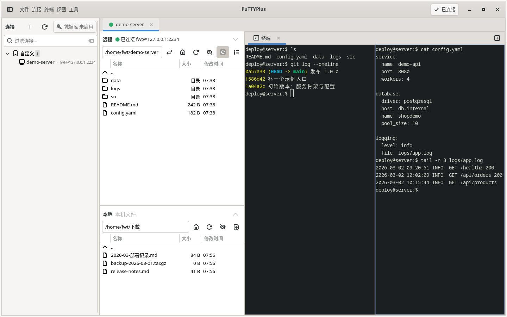
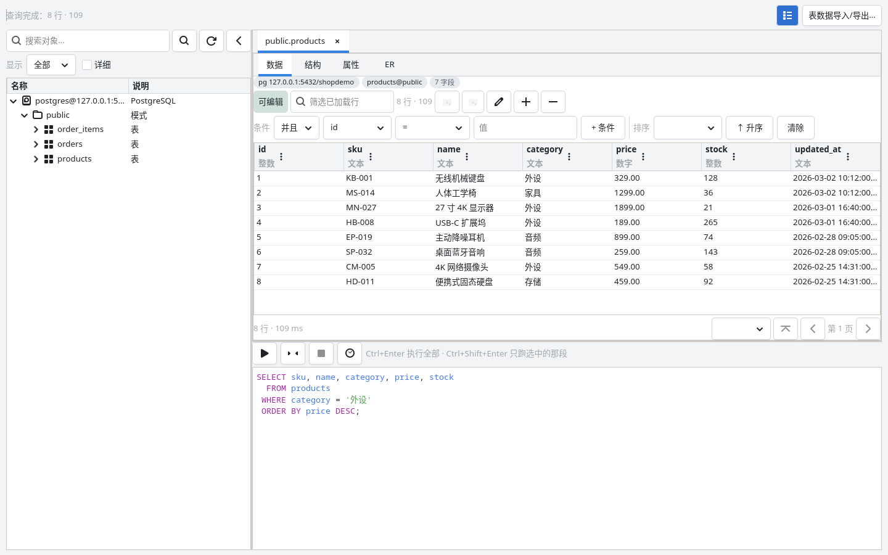

# PuTTYPlus

[](https://github.com/fwt11/puttyplus/actions/workflows/ci.yml)

**SSH 终端 + 文件传输 + 数据库 + Docker 容器，一个窗口全搞定。**
Linux / Windows 双平台，单文件程序，界面全中文。

> 在找 **PuTTY / WinSCP / Xshell / FinalShell** 的替代品？PuTTY 的命令行参数这里全认，
> WinSCP 式的双栏文件传输、集成式的数据库与容器管理，都在同一个程序里。



## 特色

- **一个窗口管全部** —— 终端、双栏文件面板、数据库工作台、容器、端口映射集成在一起，不用来回切程序
- **一台服务器，一条连接** —— 所有功能都在同一条 SSH 连接上开通道：不重复登录、不多占端口、不留后台监听
- **命令行兼容 PuTTY** —— 参数、退出码、askpass 逐字节对齐（73 条黄金基准回归），堡垒机里可直接替换 PuTTY
- **远程文件随手编辑** —— 内置编辑器带 20 多种语言语法高亮，直接编辑远程文件；二进制文件可按十六进制查看
- **数据库工作台** —— PostgreSQL / MySQL：对象树、事务化可编辑表格、SQL 编辑器、ER 图、导入导出
- **容器工作台** —— 容器 / 镜像 / 卷 / 网络，compose 项目分组展示，compose 文件就地编辑
- **凭据库** —— 主密码 + argon2 + AES-GCM 加密，连接密码集中保管；密码不进命令行、不进日志
- **跨平台单文件** —— SSH/SFTP 协议栈全部静态链接，拷过去就能跑

## 功能

### 终端

- 终端引擎可选：**libvte** 或 **ghostty**（Windows 版即 ghostty 内核 + ConPTY）
- 左右 / 上下分屏，每个页签一套独立布局；按键可同时广播到多个终端
- 会话结束一键重连；查找、复制粘贴、终端日志
- 终端里的 `cd` 实时同步到文件面板（目录跟随）

### 文件传输（SFTP）

- 远程 / 本地双栏，拖拽或右键「粘贴上传」；批量传输走队列，进度可见、可取消、可调并发
- 内置编辑器直接改远程文件（走当前连接，不用先下载）
- 上传下载与其它操作共用同一条连接，不再另建 SSH/TCP

### 数据库（PostgreSQL / MySQL）



- 对象树懒加载 + 全库搜索（表、视图、字段、函数、存储过程、触发器、事件）
- 可编辑数据网格：点「编辑」才开事务，**全部成功才提交，任何一条失败整体回滚**
- 表结构可视化编辑（字段 / 索引 / 外键），改动打包成一条 DDL 执行
- SQL 编辑器 + 执行历史；底栏常驻显示当前执行的 SQL
- CSV 导入带字段映射向导；导出支持 CSV / JSON / XML / HTML / INSERT SQL
- ER 图：外键关系画到具体列上，表框可拖动

### 容器（Docker）

- 容器按 compose 项目分组，独立容器单独列出；每 7 秒自动刷新
- 容器详情：状态、启动命令、网络与端口、挂载、环境变量；支持启停
- 镜像 / 卷 / 网络三页；容器内文件浏览
- compose 文件点开即编辑，文件面板自动跳到项目目录

### 端口映射

- 本地转发 / 远程转发 / SOCKS 代理（`-L` / `-R` / `-D`），表格管理，双击即改
- 由程序内引擎承接，不依赖系统里装没装 ssh

### 其它

- 连接管理器：会话树（最近 / 自建 / `~/.ssh/config` 别名），也能读 PuTTY 会话
- 会话录制与回放（asciicast 格式，只录屏幕内容，不录按键 —— 密码不会进去）
- 凭据库：忘了主密码可重置，连接定义不受影响
- 快速命令面板、私钥管理器（生成 / 导入导出）、串口连接
- 浅色 / 深色 / 跟随系统主题，次要文字按 WCAG AA 计算对比度

## 下载

到 [Releases 页](https://github.com/fwt11/puttyplus/releases) 取最新版本：

| 资产 | 平台 |
|---|---|
| `puttyplus_<版本>-1_amd64.deb` / `_arm64.deb` | Debian / Ubuntu 等（依赖 GTK ≥ 4.18、VTE ≥ 0.80） |
| `puttyplus-linux-x86_64.tar.gz` / `-aarch64.tar.gz` | Linux 免安装单文件 |
| `puttyplus-windows-x86_64-setup.exe` | Windows 安装包（每用户安装，免管理员） |
| `SHA256SUMS` | 校验和（`sha256sum -c SHA256SUMS`） |

## 从源码构建

依赖：Rust 1.85+、GTK ≥ 4.18、VTE ≥ 0.80、Zig 0.17.x（编译 ghostty 终端引擎）。

```bash
sudo apt install build-essential pkg-config libgtk-4-dev libvte-2.91-gtk4-dev
cargo build --release
./target/release/puttyplus
```

Linux 上想省掉 Zig 可以 `cargo build --release --no-default-features`（只用 libvte）。
Windows 构建见 [docs/跨平台-构建说明.md](docs/跨平台-构建说明.md)。

## 许可

MIT，见 [LICENSE](LICENSE)。
